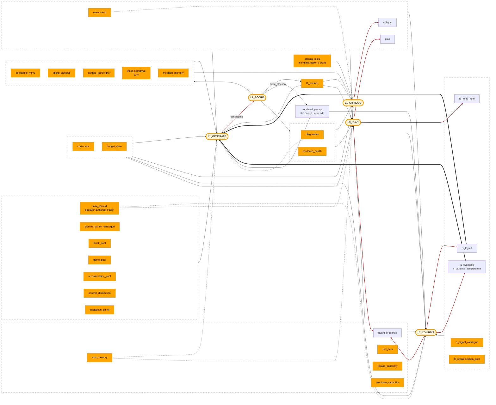

# Dispatch hub + L1 layout + L2 internals

Potter's `dispatch/` fills the `{{placeholders}}` of its optimizer prompts; `L1Layout` is the structural surface L2 edits, and L2 is one entry in the same hub (`potter/members.py::L2Context`). Concept role: [`the-loop.md`](the-loop.md).

Every optimizer LLM node renders an `OptimizerPromptTemplate`, whose `RENDER_ORDER` is cut for the provider prefix cache; the target prompt has no class — each prompt node declares its fields in render order (`NodePromptInfo.fields`), and that order sits inside the archive key. **No prompt site summarizes its own data**: a name not in `injection_table()` does not enter a prompt. The hub is stateless: `injection_table()` (`dispatch/injections/registry.py`) is built from the `@signal("<name>", …)` decorator at each renderer's definition site, and selection refuses a `{{slot}}` not in it by the config address holding it (`LayoutNode.unknown_slots`), so a typo fails at `new`. A new injection is one pure `_r_<name>(view) -> list[Item]` renderer (`facade.py::PotterView`, the node's own reads) there (`[]` when its source is empty), reached through a node's `NODE_LAYOUTS[node].floor` or `.extras`.

`citable`: may an `l1_generate` variant name this panel in `evidence_grounding`? True for panels that REPORT; False for the value-space menus and the prompt under edit — citing those grounds a mutation in its own subject. `citable_fields(layout, exploration_budget, rendered)` intersects the flag with the live layout and what rendered, fills the wire schema's enum, and the round banks it as `L1Readout.l1_citable`, which `evidence_grounding_present` reads.

## Injection map

Every registered signal (left) and the optimizer nodes it fills (right). A plain edge into a node is that node's floor, `dispatch/layout.py::NODE_LAYOUTS`; `critique_axes` alone is filled into prose, `l1_critique`'s instruction.

- **Amber pill** — an optimizer node: the four LLM prompts, plus L1_SCORE, the deterministic measured round.
- **Orange** — a deterministic input; **white** — one an LLM node wrote.
- **Dashed box** — an edge leaving it reaches every panel inside.
- **Red edge** — an LLM node's output: the loops that close the optimizer.
- **Dotted edge** — an extra: a layout edit may place it there, the floor does not.
- **Thick edge** — L2's steer, a node overlay on `l1_generate`, not a panel (§ How L2 steers L1).

## Reference

The registered signals are every `@signal(…)` under `dispatch/injections/` — each renderer is its slot's SoT — plus the caller extra `n_variants` (substituted by `compile_prompt`, capped in `l1.py`). `[fenced]` = wrapped in `<UNTRUSTED_DATASET_CONTENT>`.

### Every item that reaches an LLM carries an upper limit — bounded where it is PRODUCED

**No injectable is unbounded, and a `char_cap` alone does not bound one.** The limit lives where the text is authored — the only place an overlong item can be judged faulty rather than silently shortened:

| where it is produced | the bound that judges it |
|---|---|
| an LLM optimizer output (`plan`, `critique`, an L2/L3 field) | a `_truncate*` validator on the response model (`dispatch/schemas.py`) — the parse boundary, never a wire `maxLength` ([`structured-output.md`](../research/structured-output.md) § Enforcement is provider-dependent) |
| operator-authored framing (`task_context`) | `TaskDecomposition.check_budget` at mint — per field and in total |
| a derived/measurement view | its own `*_RENDER_CAP` top-K, bounding rows rather than characters |

`char_cap` catches only what those missed, on the indivisible panels alone: `facade.py::_cap_runaway` is the runaway backstop and emits `injection_budget_overrun`. No other panel carries one — a set of production caps chosen one at a time has a sum nobody owns.

**The composition owns the budget, the fence and the count.** Renderers hand back `list[Item]` of `(text, trusted)`; `compose.select` takes each panel's next item in layout order, round after round, until `NODE_LAYOUTS[node].discretionary_chars` is spent by the DISCRETIONARY panels alone — a smaller COMPLETE package, never half of one. **`L1_MANDATORY` is admitted whatever it costs**, served first and charged separately; one the composition cannot place raises `MandatoryPanelStarvedError`, and a renderer that raised halts the run as `RENDER_ERROR`. **Selection drops whole items and never slices one.** **A renderer never bakes its own fence** and writes no `(+N not shown)` line: an unterminated fence lets sample text run loose — a prompt-injection surface. **Row granularity is what stops starvation**: one large fenced block can only be starved whole. Which panels may be thinned is `InjectionKind.divisible` (MEASUREMENT and DERIVED thin; TRACE and DIRECTIVE are placed whole or not at all); `mutation_memory` renders newest round first, so the ceiling drops the OLDEST attempt. The response JSON Schema is prompt text too, bounded on the same rule.

### What each signal is FOR

Ordering and caps live at each `@signal`; here only the role and the rule a reader cannot get from the renderer.

**Round-end measurement** (L1_SCORE + L1_CRITIQUE):

- **`diagnostics`** ← a STATUS prefix, the fenced `RoundDiagnostics` body (`compute_round_diagnostics`, least-actionable last), and EVOLUTION — the one progress view on the one comparable column (`domain/run_standing.py::rounds_without_advance`, each round's `overlap.advance`). No fitness column: a round's fitness sits on cells the next round re-picks.
- **`l1_wounds`** [fenced] ← the last measured round's arms + `Cycle.runtime_failures`; its runtime config shows only the keys L1 may set.
- **`guard_breaches`** ← `L2Memory.guard_breaches`, `L3Memory.guard_breaches`. Evidence values render only where they name a closed vocabulary; an LLM-authored placeholder reports its size, so no untrusted content reaches the unfenced block.
- **`critique`** ← `PotterView.critique`. **A cluster spans at least two rows the panels marked as `detectable_move` names, or it is not one**: `dispatch/schemas.py::critique_response_model` drops it at parse, keeping the reply's others, against `panels.py::clustered_sample_ids` and `panels.py::detectable_rows`. The generator answers `targets_rows` as `[#id]` marks, scored by `behavior_checks.py` — an id is checkable, a label is coined freely.

**Strategic, persistent:**

- **`task_context`** ← `Cycle.framing` (`TaskDecomposition`), authored at check-in and FROZEN: no L1/L2/L3 wire schema has a field of it — the one `PREFIX_STABLE_PANELS` member. `upstream_context` / `downstream_context` render here and splice around `problem_description` into the TARGET prompt (`OptSearchPoint.scored_prompts`).

**Cross-round derived:**

- **`axis_memory`** ← `Cycle.axes()` → `AxisIndex.digest` — per-locus effect size over the closed rounds' arms (`OptSearchPoint.loci()` against each round fold's fitness); a semantic critique ranks prompt-field loci alone (`AxisImpact.kind`).
- **Panels** (`injections/panels.py`): `escalation_panel` (stall depth + `exploration_budget`; gates the `stall_exploration` citation) · `evidence_health` (per-node failure rates — an upstream fault no param mutation fixes) · `answer_distribution` (the collapse detector; `domain/scoring.py::enumerable_truth_labels` owns the rule, shared with the election's collapse refusal, and `constant_answer` the floor, which the origin round's health serves paired) · `failing_samples` (one row per miss, easiest-first on the locked δ ruler; once clustered, only rows the clusters span; never a tally by label) · `sample_transcripts` (the whole trace; a looping one, `dispatch/bundle.py::LOOP_NOVELTY`, head and tail; `panels.py::_query_excerpt` keeps the line naming the gold answer) · `inner_narratives` (each row as its PAIRED difference from the origin on the same seed) · `mutation_memory` (each edit that separated from its parent or collapsed to one label, `panels.py::_Edit.verdict`, with the cells it gained and lost, `application/scoring/paired.py::flipped_keys`; an edit inside the noise is left out, never shown as a loss) · the **decision frame**: `measurand` (what ELECTS, θ ± se), `detectable_move` (in rows), `confounds` (silent when none), `budget_state` (the one non-citable member).
- **Capability directives** (`injections/layer_state.py`: `rebase_capability`, `terminate_capability`) ride the layout channel — on the `l2_context`/`l3_plan` floors AND mandatory sets, so no prose rewrite can drop them; the config bit is the one way to silence one. `reelect_capability` rides `rebase_capability`'s directive: it adds `fork_proposal.stand_on` and the ELECTIONS table (each round's pick and how it won, its later reads as parent, the arms it beat), the one carrier of the labels `stand_on` names, so it renders only beside the field. `l1_generate`'s prose token `{{n_variants}}` is guarded by `potter/validators.py::l1_inner_placeholders_intact` on the MERGED params.
- **Directives a layer cannot cite**: `critique_axes` (the axes a critique may name, the running nodes' param keys, `layer_state.py::critique_axes`; the same list `critique` filters `suggested_axes` by) · `skill_tiers` (the SKILL.md tier ladder, rendered only where the target is delivered on demand, on the `l2_context` and `l3_plan` floors) · `l3_to_l2_note` (L3's note to L2, `L3Memory.note`, on `l2_context`'s floor).

**Current state:**

- **`rendered_prompt`** ← `parent.prompts` ⊕ `effective_optimizer_prompts(…)` — the artifact under edit. One LABELLED section per locus, `[node.field]`, in declared order (the override schema keys on those names), each carrying the field's OWN value, never a spliced one. Both halves render (target prompt and inner optimizer prompts, `domain/l4/cells.py::InnerCells.owners`), each empty where it is not the mutation surface.
- **`pipeline_param_catalogue`** ← the axes L1 may move and each value space, a one-value axis dropped; seated under `rendered_prompt` with the matcher's extraction contract.
- **`block_pool`** ← the `BlockPool` slice through `PotterView.block_window()`, gated by the node's `block_access`: the value space of a prompt FIELD. `closed` narrows each field's wire schema to the window (`potter/validators.py::l1_blocks_in_pool`); `off` renders empty.
- **`demo_pool`** ← `PotterView.demo_pool` + the node's `k_max`: the value space of the `shots` slot — the parent's shots first (the one place L1 sees them), then a `pool_window` rotating by round. `L1_MANDATORY`; silent with no pool or `k_max: 0`. `potter/validators.py::l1_shots_in_demo_pool` rejects an id outside the pool, a repeat, or a list past `k_max`.
- **`recombination_pool`** ← `Lineage.measured` ranked on `Lineage.theta`: the top `pool_window` marked main, then the rest, and the loci a main may take — the value space of the `recombinations` slot. `L1_MANDATORY` as its one carrier; silent at `recombine: 0`, under another `recombination_host`, or with no two tradable entries, which withdraws the slot. `l2_recombination_pool` is the same pool on `l2_context`'s floor under `recombination_host: l2_context`.
- **`plan`** ← `L3Memory.plan`, L3's strategic replan, which every layer's prompt reads until L3 writes the next one; silent before L3 first fires.
- **`l1_overrides`** ← `L2Memory.steered("l1_generate")`, the numeric steer L2 laid over `l1_generate` key by key; silent while L2 has laid none.
- **`l1_layout`** — a structural input and a signal, resolved ONE way for every node (`dispatch/prompts.py::node_layout`: a layer's steer, else an outer's declared edit, else the floor). On `l2_context`'s floor too, since an edit names a panel and its target slot.
- **`l1_signal_catalogue`** (L2/L3 only) ← `NODE_LAYOUTS["l1_generate"].mandatory` — the one layout rule no JSON Schema states: after an edit, each mandatory signal still sits under SOME slot, binding the MERGED layout. Absent from `l1_generate`'s `possible`.

### The fields each signal renders

🧩 follows every sub-member name — companion to the inline expansion the diagram does for `l1_overrides` (`n_variants`🧩, `temperature`🧩); lets you scan for atomic field names regardless of which placeholder owns them.

| Signal | Fields |
|---|---|
| `diagnostics` | STATUS `fires`🧩 `stall_count`🧩 · body `samples`🧩 (`terminal_node`🧩 `query`🧩 `predicted`🧩 `ground_truth`🧩 `rank`🧩 `gt_in_source`🧩 `gt_in_ranked`🧩) `near_misses`🧩 `rank_buckets`🧩 `top_k_accuracy`🧩 `error_rate`🧩 `warning_rate`🧩 `l1_yield`🧩 · EVOLUTION `l1_stall_depth`🧩 `overlap.advance`🧩 `headline`🧩 `vs_parent`🧩 `triggered_rates`🧩 |
| `l1_wounds` | validation `axis`🧩 `value`🧩 `reason`🧩 `allowed`🧩 `l1_parse_failure`🧩 · runtime `owner`🧩 `dominant_warning`🧩 `degraded_rate`🧩 `total_scored`🧩 `observed_config`🧩 |
| `guard_breaches` | `validator_id`🧩 `evidence`🧩, per layer |
| `critique` | `priority_fix`🧩 `suggested_axes`🧩 `failure_highlights`🧩 (`mechanism`🧩 `sample_ids`🧩 `claim`🧩) |
| `task_context` | `domain`🧩 `pipeline_purpose`🧩 `data_characteristics`🧩 `optimization_goals`🧩 `key_challenges`🧩 `upstream_context`🧩 `downstream_context`🧩; never `raw_description`🧩 |
| `axis_memory` | `axis_rankings`🧩 `top_values`🧩 `exhausted_axes`🧩 `persistent_failures`🧩 `failure_clusters`🧩 |
| `escalation_panel` | `exploration_budget`🧩 `l1_stall_depth`🧩 |
| `evidence_health` | `node_failure_rates`🧩 `evidence_starved_node`🧩 |
| `answer_distribution` | the `graded_answer`🧩 tally · the `enumerable_truth_labels`🧩 tally · `constant_answer`🧩 against the round's fitness |
| `failing_samples` | `sample_tag`🧩 `delta`🧩 `query`🧩 `span`🧩 `ground_truth`🧩 `predicted`🧩 `reasoning_trace`🧩 · verifier-graded `fitness`🧩 `outcome_note`🧩 `turns`🧩 `step_tokens`🧩 |
| `sample_transcripts` | `sample_tag`🧩 `query`🧩 `reasoning_trace`🧩 `span`🧩 `ground_truth`🧩 `predicted`🧩 · verifier-graded `fitness`🧩 · `judge_readings`🧩 · a lost cell's `lost`🧩 `tried`🧩 `by`🧩 |
| `inner_narratives` | `sample_tag`🧩 `query`🧩 `held_out_lift`🧩 `mean_round_delta`🧩 `mean_parent_level_se`🧩 `paired`🧩 `reasoning_trace`🧩 |
| `mutation_memory` | per edit `label`🧩 `fitness`🧩 against the parent's, `composite_fitness`🧩, `changed`🧩 (a param's value, a field's `changed_words`🧩, `shots`🧩), `gained`🧩 `lost`🧩, `same_idea`🧩 · the cells edits keep missing, `lost`🧩 of `tried`🧩 |
| `measurand` | `composite_fitness`🧩 · frontier `theta`🧩 `se`🧩 · `evaluators`🧩 under a charged formula |
| `detectable_move` | `detectable_rows`🧩: the expected information of `latest_sample_keys`🧩 at `parent_ability`🧩, both arms, at `admission`🧩 |
| `confounds` | the frontier's `caveat`🧩 in `THETA_CAVEAT_INFO`'s `label`🧩 `detail`🧩, with its number (`round_span`🧩 `ruler_span`🧩, `unlinked`🧩, `pinned_share`🧩) · a subset moved whole (`latest_sample_keys`🧩, `prev_sample_keys`🧩) |
| `budget_state` | `round_num`🧩 `budget_rounds`🧩 `spend_used_usd`🧩 `spend_budget_usd`🧩 |
| `rebase_capability` | `fork_proposal`🧩 (`reason`🧩 `unlock_schema_field_rename`🧩 `stand_on`🧩) · ELECTIONS `picked`🧩 `locked_in`🧩 `unelected`🧩 |
| `terminate_capability` | `terminate_proposal`🧩 (`reason`🧩) · `terminate_offer`🧩 |
| `critique_axes` | each `open_prompt_fields`🧩 locus, its `shots`🧩, each running node's `param_keys`🧩 |
| `skill_tiers` | `VALID`🧩 `NO REPEATS`🧩 `LIFT`🧩 |
| `l3_to_l2_note` | `note`🧩 |
| `plan` | `plan`🧩 |
| `rendered_prompt` | `[node.field]`🧩 per `prompt_fields`🧩, a closed one marked held · the inner nodes' `[node.field]`🧩 per `RENDER_ORDER`🧩 |
| `pipeline_param_catalogue` | `node_param_keys`🧩 `param_options`🧩 `param_indistinct`🧩 `param_descriptions`🧩 `prose_ceiling`🧩 · `output_schema_descriptions.<path>`🧩 · `response_format`🧩 + the matcher's `note`🧩 |
| `block_pool` | per field `id`🧩 (closed only) `text`🧩 |
| `demo_pool` | the parent's `shots`🧩 per node, `shot_k_max`🧩 · each row's `sample_tag`🧩 `query`🧩 `ground_truth`🧩 |
| `recombination_pool`, `l2_recombination_pool` | each entry's `id`🧩 `theta`🧩 `main`🧩 and `recombination_loci`🧩 values · answered as `main`🧩 `donor`🧩 `from_donor`🧩 `changes_description`🧩 |
| `l1_layout` | `persona`🧩 `task_intent`🧩 `thinking_style`🧩 `problem_description`🧩 · the `possible`🧩 panels in no slot |
| `l1_overrides` | `n_variants`🧩 `temperature`🧩 |
| `l1_signal_catalogue` | `mandatory`🧩 less `silent_l1_panels`🧩 |

## Mechanics

- `facade.py::PotterView` reads the node's own context, whose LAST round the bench folds in (`Cycle.absorb_round`) before its adapters run, so `l1_critique` reads the round it distils.
- Two prose tokens fill a value: `{{n_variants}}` in `l1_generate` (a caller extra) and `{{critique_axes}}` in `l1_critique`'s instruction (a signal, filled after the layout panels). Every `problem_description` body is empty: its panels come from the layout.
- **`L1_MANDATORY` is two kinds**: a field L1 cannot OPERATE without (parent prompt, plan, framing, mutation surface, failure digest), and the sole carrier of a state L1 must not enter BLIND (`answer_distribution`, `measurand` + `confounds`, `failing_samples`). Missing after a merged edit fires `l1_layout_missing_mandatory`, a guard breach routing to L3.

## L1 layout — L2's structural edit surface

L1_GENERATE's prompt is composed by walking a per-slot list of injection names (`records.py::L1Layout`, declared IN RENDER ORDER) through the registry. L2 owns the layout; the registry is closed and code-derived. Static text in each slot stays; `answer_format` is not a slot (L1's output schema, a code contract). An injection needing to differ per layer is two injections.

**`VOLATILE_SLOT` is the provider prefix-cache boundary**: a changing panel ahead of it re-bills the static template at full rate every round. An import-time assert holds every floor behind the line; `validate_l1_layout` reports an EDIT that crosses it (`l1_layout_voids_prefix`, soft — placement is a real axis). `PREFIX_STABLE_PANELS` is the exemption, and **membership is a claim about a WRITER, not a renderer**: `task_context` is its one member because no layer writes the operator's framing.

**Default floor** — `NODE_LAYOUTS["l1_generate"].floor`. Order is priority: `dispatch/compose.py` selects in layout order, so the decision frame is placed before a large panel can crowd it.

**Validation — HARD / SOFT.** `validate_l1_layout(layout, *, spec, prior_layout)` against the node's `NodeLayoutSpec`:

- HARD — missing mandatory placeholder, name outside the node's `possible`. L2's edit keeps the prior layout and appends to the guard-breach stream. An L4 override is REJECTED at proposal (`potter/validators.py::l1_inner_layout_applies`) and rides `validation_failures` — substituting the floor would spend an inner campaign on the parent's information flow. `resolve_layout_override` is the one derivation both boundaries ask.
- SOFT — `l1_layout_voids_prefix`, `l1_layout_unchanged_from_prior`: applied, reported on the same stream; a `ValidatorOutcome` carries no score and no severity, so no consumer escalates on the stream alone (§ Trigger — when L2 fires: a refusal, not the stream, fires L3).

**A signal sits in at most ONE slot** — `fill` appends one render per occurrence. An edit names the slot a panel moves to, so only the floor could name one twice, and `dispatch/layout.py`'s import-time block asserts it does not.

## Trigger — when L2 fires

The `ladder` slice (`records.py::Ladder`) is a frozen value replaced whole and banked on the round it stands on. After every L1 round `bank_round` (`escalation.py::bank_and_route`) applies the `StallEffect` `domain/origin_panel.py::RoundAdvance` declares (`stall`) for the round's `overlap.advance`; at `l1_patience` L2 fires. Preemptors fire L2 before patience (`escalation.py`); `l1_evidence_starved` routes a starved round to L2 so it can read `evidence_health` and refine or **terminate**. Deterministic rules only route: termination belongs to the most-general reader, and a backend-coupled deterministic check only WARNS. The decision is `escalation.py::L2EscalationTrigger` (`inputs_ref.reading.rule` names the rule), ARCHIVAL (no `Replayed`): a fold over the cycle's escalation history, not a function of one round. On resume the ladder is taken from the last standing round's `optimizer_state` (`SliceMap.seat`), not re-derived.

**A REFUSED L2 layout edit fires L3 at once**, bypassing both patiences, and not on an `escalation_ladder` that stops short of L3; it is deterministic from L2's output on the round file, so a resume reproduces it without a decision record. The trigger reads the refusal (`TransitionResult.l1_layout_refused`: a HARD breach, or an edit naming a slot the node does not open, `dispatch/layout.py::unplaceable_edit`), never the guard-breach stream, which also carries the inert SOFT outcomes. A heal answers a refusal, not a stall, so it leaves the reading `l3_patience` compares untouched (`escalation.py::l3_fired`); every L3 fire banks an `L3_ESCALATION_TRIGGER` whose `inputs_ref.heal` says which kind it was.

## Inputs and outputs

L2's injection set is `NODE_LAYOUTS["l2_context"].floor`; no L2-only surface object exists. A refused edit fires L3 at once, so by L2's next fire it reads the new `plan`. The wire model is `dispatch/schemas.py::L2ContextOutput`; every field is optional at the PARSE boundary — a missing one leaves its state untouched. The LEVERS: `l1_layout`, `l1_overrides` and, under `recombination_host: l2_context` (`L2RecombiningOutput`, closed on the `l2_recombination_pool` ids), `recombinations`; a fire touching none is scored by `l2_targets_l1_surface`. The REASON — `axis_targeted` + `rationale` — rides every fire (`l2_rationale_substantive`, `l2_evidence_anchored`); an absent rationale is REPORTED, never replaced by a stand-in. `terminate_proposal` is the HITL exit: the cycle halts (`StopReason.OPTIMIZER_ABORT`). Both control outputs are gated by their capability bit — [`potter/CLAUDE.md`](../../promptpotter/application/optimizers/potter/CLAUDE.md) § The layer-control channel. Two fields the schema deliberately lacks: `task_context` (frozen) and `action` (probe rounds are not wired — [`../specs/roadmap.md`](../specs/roadmap.md) § Probe rounds).

`axis_targeted` is the evidence anchor, NOT a steering surface (L1 reads its axes from `axis_memory`). `l1_layout` is **a per-slot EDIT, not a replacement** — it moves the listed panels and keeps the rest (`coerce_l1_layout`, the same rule L4's `layout` param takes), addressing only the slots `NodeLayoutSpec.slots` opens (for `l1_generate` the volatile slot alone); `l1_overrides` are numeric, laid key by key over the standing steer.

### How L2 steers L1

Two channels, ONE carrier — a node overlay on `l1_generate` (`L2Memory.steer`), keyed as that node's config is:

| Channel | Overlay key | L1 effect |
|---|---|---|
| Attention | `layout` (whole, validated) | `DispatchHub.fill` walks it and appends each named injection to its slot |
| Exploration | `n_variants`, `temperature` | the next call — `n_variants` via the `{{n_variants}}` caller extra, `temperature` out-of-prompt |

Anything L2 wants L1 to see is a registered injection in `l1_generate`'s `possible`; L1's static template text and `answer_format` are out of its reach.

### Side effects — `L2Context.land`

Memory and ladder (`records.py::L2Memory`, `L3Memory`, `Ladder`) are potter's state slices, each written by one layer and never a field of the individual, so they carry across every adoption and every round banks them as `optimizer_state`. What the models cannot say: **`L3Memory.note` is sticky free-text**, cleared only when L3 fires again; **the L1 critique is on neither memory** (`RoundResult.critique`); `task_context` rides `Cycle.framing`. **A fire lands after its round closed, so it restates that round's state** (`NodeContext.restate` → one `RoundRestatedRecord`): the last standing state is the one restore a resume or a fork has.
