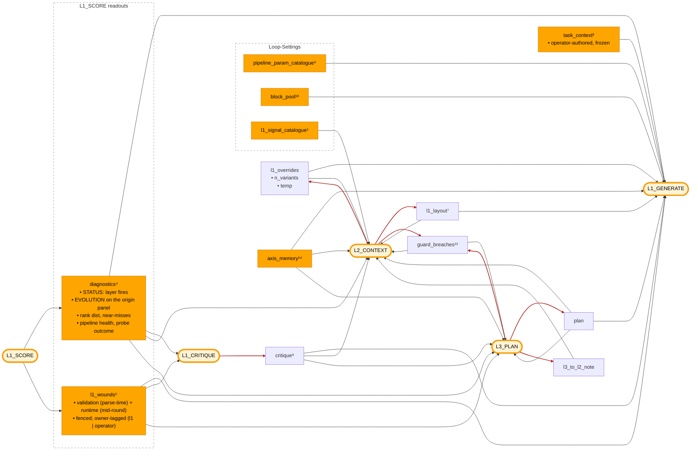

# Dispatch hub + L1 layout + L2 internals

Visual + reference for `promptpotter/application/optimizers/potter/dispatch/` — the registry that fills `{{placeholders}}` in the four optimizer prompts — and for `L1Layout`, the structural surface L2 edits to decide what L1_GENERATE sees. **L2_CONTEXT firing lives here too**, from § Trigger down: L2 is one entry in this hub — its manifest node's member (`potter/members.py::L2Context`), a `Layer` as L3 is, same `fill` path (from its `NODE_LAYOUTS["l2_context"].floor`), same `Bundle` per-call state, and the hub is what stops it accumulating its own renderers, surface object and escape hatches. Concept role: [`../concepts/the-loop.md`](../concepts/the-loop.md).

The hub is stateless. `injection_table()` is a `Mapping[str, _Injection]` built and checked on its first call — each entry carries `name`, `kind` (MEASUREMENT / DERIVED / TRACE / DIRECTIVE), `render: InjectionBundle → list[Item]`, a `char_cap` and a `citable` flag, registered by the `@signal("<name>", …)` decorator at the renderer's definition site. `validate_template()` (called from `load_optimizer_prompt`) raises on `{{slot}}` names not in the registry: a typo in a template fails at template load, not at first render.

`citable` answers one question: may an `l1_generate` variant name this panel in `evidence_grounding`? True for panels that REPORT (what was measured, what failed, what the layers steered); False for the value-space menus and the prompt under edit — citing those grounds a mutation in its own subject. `citable_fields(layout, exploration_budget, rendered)` intersects the flag with the node's **live layout** and what rendered, so what L1 may cite is exactly what L1 was shown; that call fills the wire schema's enum — the one place the menu is stated — and the round banks it as `L1Readout.l1_citable`, which is what the `evidence_grounding_present` check reads. Adding a panel to a floor makes it citable automatically.

## Flow

Inputs (left) fill placeholders in optimizer process nodes (right).

- **Amber pill** — optimizer process node: the four LLM prompts (L1_GENERATE, L1_CRITIQUE, L2_CONTEXT, L3_PLAN) plus L1_SCORE (deterministic).
- **Solid orange** — deterministic input (schema, measurements, counters, constants).
- **Default node** — AI-generated input (content originates from another LLM stage).
- **Red arrow** — LLM-produced edge: the feedback loops that close the optimizer. L1_SCORE outputs (`diagnostics`, `l1_wounds`) are computed, so they draw in normal color. `guard_breaches` (post-parse validators on L2's / L3's own output) is LLM-produced, so its producer edges are red.



## Reference

**The registered signals** are every `@signal(…)` across four modules (`injections/layer_state.py` · `panels.py` · `catalogues.py` · `wounds.py` — each renderer is its slot's SoT), plus 2 caller extras (`n_variants`, `citable_fields`). The highest-traffic slots are detailed below, grouped by role; numbered items map to the diagram superscripts. `[fenced]` = output wrapped in `<UNTRUSTED_DATASET_CONTENT>` (echoes raw query + GT text — the STATUS prefix on `diagnostics` is plain, only the dataset-content body is fenced). 🧩 follows every sub-member name — companion to the inline expansion the diagram does for `l1_overrides` (`n_variants`🧩, `temperature`🧩); lets you scan for atomic field names regardless of which placeholder owns them.

### Every item that reaches an LLM carries an upper limit — bounded where it is PRODUCED

**No injectable is unbounded, and a `char_cap` alone does not bound one.** The limit has to exist where the text is *authored*, because that is the only place an overlong item can be judged **faulty** rather than quietly shortened — truncating at render turns a producer's fault into silent content loss with nobody at fault and every gate green. Bound it where it is written, cap it where it is rendered, let the composition spend what is left.

| where it is produced | the bound that judges it |
|---|---|
| an LLM optimizer output (`plan`, `critique`, an L2/L3 field) | `max_length` + a `_truncate*` validator on the response model (`dispatch/schemas.py`) — the parse boundary |
| operator-authored framing (`task_context`) | `TaskDecomposition.check_budget` at mint — per field **and** in total, so five legal fields cannot compose an illegal framing |
| a derived/measurement view | its own `*_RENDER_CAP` top-K, which bounds rows rather than characters |

`char_cap` catches only what those missed, and only on the indivisible panels (`@signal(char_cap=…)` where `kind.divisible` is false). No other panel carries one: a production cap pre-decides how much a panel takes against a ceiling the panel cannot see, and a set of such caps chosen one at a time has a sum nobody owns.

**The composition owns the budget, the fence and the count — because a panel can see none of them.** Renderers hand back `list[Item]` of `(text, trusted)`; `compose.select` takes each panel's next item in layout order, round after round, until the node's `discretionary_chars` is spent by the DISCRETIONARY panels alone. A panel sizing itself guesses against the wrong number, one fence wraps each contiguous untrusted run so no selection leaves one open, and a panel states what it has while only the composition sees what it showed. What a renderer must do about them:

- **`L1_MANDATORY` is admitted whatever it costs**, served first and charged separately — a first claim on a budget is not the same promise as being present. A mandatory panel the composition cannot place raises `MandatoryPanelStarvedError`.
- **Selection drops whole items and never slices one**, and every panel places its first item before any panel places its second, so no panel can crowd the package by being large.
- **A renderer never bakes its own fence** and writes no `(+N not shown)` line: it cannot know where the selection will cut, and an unterminated fence lets sample text run loose to the end of the prompt — a prompt-injection surface.
- **Row granularity is what stops starvation.** A panel handing back one large fenced block cannot be thinned, only starved whole.

Which panels may be thinned is `InjectionKind.divisible`, asked of the kind every signal already declares: MEASUREMENT and DERIVED are evidence and thin gracefully, TRACE and DIRECTIVE carry state and are placed whole or not at all. Asked of the kind rather than a set of names, because a set silently skips whatever it failed to list. `mutation_memory` renders **newest round first**, so what the ceiling drops is the OLDEST attempt. `prompt_chars` stays the measurement, and what selection dropped rides beside it.

Each entry in `injection_table()` is a frozen `_Injection(name, kind, render, char_cap, citable)` — `char_cap` set only on the indivisible panels. `kind` is one of:

- **MEASUREMENT** — deterministic round-end output (e.g. `l1_wounds`, `guard_breaches`).
- **DERIVED** — view/digest over the round's diagnostics, MeasurementArchive or AxisIndex (e.g. `diagnostics`, `axis_memory`).
- **TRACE** — narrative state from prior LLM calls (e.g. `critique`, `plan`, `task_context`).
- **DIRECTIVE** — short-lived directive consumed by exactly one downstream layer (e.g. `l3_to_l2_note`).

### Round-end measurement — what L1_SCORE + L1_CRITIQUE leave behind

This is where the reader's mental model of a round usually starts: candidates were scored, results condensed, critique produced. These outputs are what the next round's prompts read.

- ⁴ **`diagnostics`** ← STATUS prefix (plain) + fenced `RoundDiagnostics` body + EVOLUTION (plain)
  - **STATUS prefix** ← `bundle.cycle_slice` — `L2 fired`🧩 / `L3 fired`🧩 (count + stall), only once one has. The round is `budget_state`'s and the L1 stall EVOLUTION's: each fact said once.
  - **Body** [fenced] ← `bundle.digest.diagnostics`: `RoundDiagnostics` from `compute_round_diagnostics` (built deterministically by L1_SCORE) — rank dist + top-k, pipeline-health termination split, failures by step / warning class, near-misses, L1 yield, cache-share, miss-sample, prompt-size warning, probe outcome 🧩 — least-actionable last, so those are the first the ceiling refuses
  - **EVOLUTION** ← `bundle.measured_rounds` — the ONE progress view, on the one comparable column: the L1 stall (`domain/results.py::rounds_without_advance`), each recent round's `overlap.advance` label, and the origin panel's line (C0 and each pick on the same fixed rows, the standing pick's CI against C0, a pick reading below its parent, the arms read and never adopted). **No accuracy column**: a round's own accuracy sits on cells the next round re-picks, so it is no series.
- ⁵ **`l1_wounds`** [fenced] ← the last measured round's arms (`ArmState.validation_failures`, and the round's `l1_parse_failure` where it produced none) + `Cycle.runtime_failures` (this cycle's rounds and its concluded siblings', derived at each read) · L1-owned wounds, one block
  - **Validation** (parse-time): `axis`🧩, `value`🧩 (LLM-proposed), `allowed`🧩, `reason`🧩 — from the reject gates in `validators/l1_strict.py`; synthetic-0 per-candidate, except `reason=hallucinated_node` which is non-fatal routed signal.
  - **Runtime** (mid-round): per-candidate `DegradationCheck` evidence, owner-tagged (`owner=l1` retune · `owner=operator` flagged, not in-loop fixable); accumulates cross-round (NEW vs ACCUMULATED). Its config shows only the keys L1 may set whose values are a closed vocabulary or a number (`node_param_keys` × `param_kind`), so a route or provider it cannot touch never reads as a lever.
  - Fenced (echoes LLM-proposed values + the backend's own warning codes). Renderer `_r_l1_wounds`.
- ¹² **`guard_breaches`** ← `L2Memory.guard_breaches`, `L3Memory.guard_breaches` · post-parse breaches, both owner=L3 (replan)
  - Plain: `validator_id`🧩 plus its `evidence`, whose values render only where they name a signal, a slot or a target prompt field — all closed vocabularies. An LLM-authored placeholder or plan reports its size, so no untrusted content reaches the unfenced block. Renderer `_r_guard_breaches`.
  - Set by L2/L3 post-parse validators. A REFUSED L2 layout edit force-triggers an immediate L3 fire (§ Wound 4 — off `TransitionResult`, never off this stream, two of whose members are inert); L3 also reads its own past breaches to avoid repeating them.
- ⁸ **`critique`** ← `bundle.digest.critique` (L1_CRITIQUE output, consumes ⁴ + ⁵)
  - Compact view via `format_l1_critique_for_prompt`
  - `priority_fix`🧩, `suggested_axes`🧩, `failure_highlights`🧩 — ≤3 `FailureCluster`s, each `sample_ids` + `mechanism` + `claim`. **A cluster spans ≥2 rows the panels marked or it is not one**: `minItems` on `sample_ids` is advisory on a `strict: False` wire, so `l1/critique.py::spanning_clusters` decides against the ids `panels.py::clustered_sample_ids` reads off the same bundle, dropping what spans fewer (`critique_cluster_dropped` on the warnings channel). **Rows are the key, never a label**: the generator answers `targets_rows`, ids it reads as `[#id]` marks, and `validators/l1_behavior.py` scores a variant whose rows are unmarked, fewer than two, or spread over two clusters (`targets_a_cluster`) — a label is coined freely on that wire, an id is checkable against the prompt. `[#id]` is the one mark for a row a cluster may span, so a panel whose rows are not such does not use it.

### Strategic injects — L3_PLAN writes the plan, the operator authors the framing, persistent

- **`plan`** ← `L3Memory.plan` · L3_PLAN-only writer; each fire replaces it whole.
- ³ **`task_context`** ← `Cycle.framing` (the campaign's)
  - 5 framing fields: `domain`🧩, `pipeline_purpose`🧩, `data_characteristics`🧩, `optimization_goals`🧩, `key_challenges`🧩 — plus the two splice fields below, so 7 render here; all seven are frozen
  - Authored at check-in (`CheckinOutput.task_context`, edited by the operator before mint) and **FROZEN there** — on `l1_generate`'s floor only (`NODE_LAYOUTS`); `l2_context` / `l3_plan` hold it in `possible`, an axis L4 can search back in. No L1/L2/L3 wire schema has a field of it, so no fire can move a byte of it. That is what puts `task_context` in `dispatch/layout.py::PREFIX_STABLE_PANELS` — the one panel a floor may place ahead of `VOLATILE_SLOT` without voiding the provider's prefix cache, measured surviving all of `task_intent` on a live round pair.
  - `raw_description`🧩 renders nowhere. `upstream_context`🧩 / `downstream_context`🧩 render HERE and also splice around `problem_description` into the TARGET prompt of the ONE prompt node declaring it (`OptSearchPoint.scored_prompts`) — even an empty one. This panel is the only place L1 sees them as context: `rendered_prompt` reads each node's own fields, so the field it offers for replacement does not carry them
- **`l3_to_l2_note`** ← `L3Memory.note` · L2_CONTEXT template only; explicitly excluded from L1_GENERATE.

### Cross-round derived

- ¹⁴ **`axis_memory`** (DERIVED) ← `Cycle.axes().digest()` (folded once per process, its flips derived from the rounds) — AxisIndex per-axis effect_size + sample-coverage; consumed by L1_GENERATE, L2_CONTEXT, L3_PLAN. Empty when AxisIndex isn't yet initialised (round 1); param rankings are hidden when the critique named only prompt-field axes, the sample-side rows staying.
- **Panels family** (`injections/panels.py`, MEASUREMENT or DERIVED per each one's own `@signal`). This roster says what each is FOR and when it stays silent: `escalation_panel` (L1 stall depth + `exploration_budget` — gates the `stall_exploration` citation), `evidence_health` (per-node failure rates — flags an evidence-starved enricher, an upstream fault no param mutation fixes; silent on a healthy round), `answer_distribution` (the collapse detector — accuracy cannot tell reasoning from one repeated label; silent on free text. It renders the rule but does not own it: `domain/scoring.py::enumerable_truth_labels` is the one definition of "is there a constant to detect here", shared with the scoring gate that withholds θ from a collapsed candidate and with PoBB, which eliminates it), `failing_samples` (a current miss as ONE row — while unclustered, first the rows whose answer and truth share a contiguous word span (the reasoning landed, the extent did not), then the easiest on a fitted δ, then at most `MISS_TIED_CAP` each of the rows on a tied δ (the ruler's prior, no order) and of those the ruler does not carry, within `MISS_ROWS_CAP`; once clustered, only the rows the critique's clusters span, so the generator reads no id whose row it cannot see — its `[#id]`, its δ, the query stem, what was said against the truth and the last reasoning step, which a row `sample_transcripts` quotes whole omits; or, with no label, the verifier's `outcome_note` and the turns and tokens the cell spent — easiest-first on the cycle's locked δ ruler; never a tally by label, since a cluster is a mechanism and a tally shows none; a cold ruler renders the misses unordered rather than quote a δ that would move; mandatory on the critique beside `inner_narratives`, its counterpart one level up, so every row a cluster may span renders; and silent where `inner_narratives` owns the rows), `sample_transcripts` (silent on that same ownership, never on label presence: a verifier-graded cell has no label and no narrative, and must not fall silent on both; a trace whose second half adds under `LOOP_NOVELTY` compressed bytes per character to its first is looping and shows head and tail only), `inner_narratives` (each row as its PAIRED difference from the origin on the same seed, worst-CONFIDENT first), `mutation_memory` (silent before any edit; what this cycle has ALREADY tried: each edit as the words it wrote and cut against the parent it was mutated from — the round BEFORE its own — what it scored against that parent — accuracy, plus the composite where θ is fit on a `per_cell` formula — how it ended, and the cells it GAINED and LOST there (`application/scoring/paired.py::flipped_keys`, the two sides paired on `Sample.key`), with the cells edits keep missing summed beneath. On the critique's floor as well as the generator's, and `sample_transcripts` leads with those cells' missing runs for the same reason). Beside them the **decision frame** — short, self-suppressing, and the half a reader needs before any of the above means anything: `measurand` (what ELECTS and the frontier θ ± se it reads — each sample's latest cell, whoever measured it; under a charged `per_cell` formula, then what is reported beside it and decides nothing — never named as one objective, or a formula term the election does not read steers at nothing), `detectable_move` (the smallest gain this round could tell from zero, in ROWS: the contrast se's detectable θ move, summed as expected extra wins over the round's rows on the ruler's δ; silent without an ability SE), `confounds` (cold ruler / collapsed δ band / subset moved whole — MEASURED, not warned about in advance; silent when none is, or a caveat rendering every round reads as boilerplate), `budget_state` (the round, of how many, and spend; the one non-citable member).
- **Capability directives** (`injections/layer_state.py`): `rebase_capability` / `terminate_capability` (conditional escape-hatch instructions into L2+L3 prompts; render empty when the config knob is off so ablation prompt bodies stay bit-identical). They **ride the layout channel** — on the `l2_context`/`l3_plan` floors AND mandatory sets, so an L4 layout edit that excises one is rejected before it is measured (`validate_l1_layout`); no prose `{{token}}` carries them, so a prose rewrite *cannot* drop them. The config bit is the one sanctioned way to silence a directive. `skill_tiers` rides the same two floors, unguarded by `mandatory`: the three-tier search order for a skill body, rendered only where `InjectionBundle.prompt_delivery` is the on-demand channel (`Connector.prompt_delivery`), so no other target's L2 or L3 reads it. The base optimizer prompts' remaining prose token is the INLINE caller extra `{{n_variants}}` on `l1_generate` — a port that can never ride layout (it sits mid-sentence), guarded instead by `validators/l1_strict.py::l1_inner_placeholders_intact` → `dropped_mandatory_placeholder` (synthetic-0), checked on the MERGED params so inherited breakage flags too.

### Current state

- **`rendered_prompt`** ← `parent.prompts`, per prompt node in its declared order **⊕ `effective_optimizer_prompts(pipeline_schema, pipeline_params, inner_cells)`**
  - Each node's base prompt is `inner_template`'s: the manifest whose lever the node is across the panel's cells (`runner/inner/tasks.py::InnerCells.owners`), never the outer's own — a CAPO inner is shown, and its edits checked against, CAPO's prompts. `l1_strict`'s inner-prompt checks and the wire schema's `maxLength` read the same binding.
  - Both halves render one LABELLED section per locus, `[node.field]` — each prompt node's fields for the target prompt (a field the node holds closed marked HELD), each inner node's for the optimizer prompts. The override schema keys on those names, so an unlabelled blob would ask the generator to attribute a paragraph whose boundary the render had stripped. The sections walk each node's declared order, the order its render joins, so one cannot claim a boundary the other lacks, and carry each field's OWN value: only `scored_prompts(schema, framing)` splices the campaign's upstream/downstream framing into `problem_description`, and a replacement written over a spliced value would absorb that framing as prose the next render splices around again. The framing reaches L1 through `task_context` instead.
  - Structurally L1_SCORE's output: each round's winner becomes next round's `Cycle.parent`, so its render is the next parent prompt. The cycle lives in orchestration, not the diagram.
  - The panel is **the artifact under edit**, and on the recursion that is not the searchpoint: an L4 outer point holds no prompt locus (its schema's `prompt_nodes()` is empty), while the real levers are the inner nodes' own `OptimizerPromptTemplate` fields carried as `pipeline_params`. Both halves render, each empty where it is not the mutation surface — so a normal campaign is bit-identical and L4 stops rendering a MANDATORY panel as nothing. Base ⊕ the parent's adopted overrides, whole fields only: every mutation here is a complete-field replacement, so a truncated render would be worse than an absent one (hence the cap sits above the recursion's own ~10k bundle).
- ⁹ **`pipeline_param_catalogue`** ← `pipeline_schema`: `node_param_keys`🧩 for WHICH axes, `param_options`🧩 for each one's value space (the one resolver — model catalogue, campaign narrowing and the picked model's refusals all answer there). An axis whose space is ONE value never reaches either: `node_param_keys` drops it (`PipelineSchema.pinned`), so the catalogue, the wire schema and `l1_strict` agree without each testing for it, and a variant cannot spend its mutation proposing the value already running. Two axes carry a precondition the menu cannot show, so they print a block under their node: the prose under each open description key, read off the point being improved and named as text sent WITH the node's prompt — which is why the floor seats this panel directly under `rendered_prompt` — and what leaving the schema costs — the run's matcher's own extraction contract (`matchers::MATCHERS`' `note`, the matcher read off `Scorer.matcher`), so `response_format=text` and the `answer_format` rewrite it forces land in ONE variant.
- ¹³ **`block_pool`** ← the `BlockPool` slice (`domain/pool.py`, seeded at run init by `optimizers/pools/members.py::BlockPoolInitializer`, earned blocks first) through `InjectionBundle.block_window()`, gated by the `l1_generate` node's `block_access`. The value space of a prompt FIELD, as `pipeline_param_catalogue` is the value space of a pipeline PARAM. A library block is seeded only where the run holds what it presumes (`PromptBlock.presumes`): candidates to rank where the chain `emits_ranking`, a last-line answer where the cell's matcher admits one (`Matcher.admits`); a mint naming a block its run cannot hold is refused before spend. `open` offers a rotating window of the active entries as material L1 may adapt or ignore; `closed` shows their ids and narrows each field's wire schema to them (an id outside the window fails `validators/l1_strict.py::l1_blocks_in_pool` → synthetic-0 → L2 wound, the same shape as a forbidden axis); `off` renders empty, leaving the prompt bit-for-bit identical to a no-pool ablation.
  - ≤4 enum values per param, ≤40-char description fallback, ≤8 models
- **`demo_pool`** ← `InjectionBundle.demo_pool` + the `l1_generate` node's `k_max` · the value space of the `shots` slot (per prompt node, as demo-pool ids), as the block library is a prompt field's: the parent's shots first — the one place L1 sees them, since `rendered_prompt` reads each node's fields and shots render only in the target — then a `DEMO_POOL_RENDER_CAP` window of the rest that rotates by round, ids and fenced stems only. `L1_MANDATORY` for that reason, and silent with no pool or `k_max: 0`, which withdraws the slot through `_SLOT_PANEL`. The shot rule itself is [`README.md`](README.md) § 1. Prompt structure.
- **`l1_overrides`** ← `L2Memory.steered("l1_generate")` — L2's node overlay on `l1_generate`, less its `layout`
  - The two call settings L2 moves, named as that node's own config names them: `n_variants`🧩, `temperature`🧩 — which keys land is `L2Context.steers`
  - `n_variants`🧩 enters L1_GENERATE only via the `{{n_variants}}` caller extra (a directive — L1_GENERATE obeys)
  - `temperature`🧩 sets the L1_GENERATE LLM call's temperature; never reaches the prompt text
  - The wire field, injection and placeholder share the name `l1_overrides`
- ⁷ **`l1_layout`** ← `node_layout("l1_generate", l2)` · the one name that is BOTH a structural input and a signal
  - L2_CONTEXT-only writer; consumed by `DispatchHub.fill` as `l1_generate`'s per-slot injection-name list that drives the slot walk. ONE resolution for every node (`dispatch/prompts.py::node_layout`): the `layout` a layer steered onto it (`L2Memory.steer`), else an outer's declared edit, else `NODE_LAYOUTS[node].floor`
  - Decides *which* injection renderings land in each L1 addressable slot (`persona`🧩, `task_intent`🧩, `thinking_style`🧩, `problem_description`🧩 — render order) — content is rendered separately by the listed injections' `_r_*` functions
  - Registered too, on `l2_context`'s floor only — the writer's view of what it is about to move, the twin `l1_overrides` always had. An edit names a panel and the slot to move it to, so what a writer needs to read is where each one sits now

### L2_CONTEXT / L3_PLAN-internal

- ¹ **`l1_signal_catalogue`** ← `NODE_LAYOUTS["l1_generate"].mandatory` (`dispatch/layout.py`) · the one layout rule no JSON Schema can state — after an edit is applied, each mandatory signal must still sit under SOME slot. It binds the MERGED layout, which is what `validate_l1_layout` is handed, so it constrains what an edit may take AWAY and never asks L2 to restate slots it is not changing. The slots and the signal enum ride `l1_layout`'s own schema (`layout_json_schema`, one builder shared with L4's per-node `layout`), so this panel names neither.

### Caller extra — L1_GENERATE template scalar (`l1/generate.py`)

Substituted directly by `compile_prompt`; not a signal.

- **`n_variants`** ← `min(L2Memory.steered("l1_generate")["n_variants"], opt.n_variants × 3)`, capped in `l1/candidate_source.py` · directive — L1_GENERATE obeys.

## Mechanics

- **Entry points** — two, both stateless: `render(name, bundle)` (internal, one injection's text) and `fill(template, bundle, *, node)` (**every** optimizer node; the layout is resolved inside from `node` via `node_layout`, never passed in). `InjectionBundle` is the per-call frozen state `(parent, pipeline_schema, cycle_slice, digest)`, built once via `build_bundle(cycle)`; `digest` is a `RoundDigest` over the cycle's LAST round. The bench folds a round in (`Cycle.absorb_round`) before its adapters run, so `l1_critique` reads the round it distils there like every other node — on the winner's params, that round's runtime failures already in `l1_wounds`.
- **Fill** — one path for every node: `fill(template, bundle, *, node)` walks the node's layout (per-slot injection-name lists, resolved by `node_layout`), selects items under the node's discretionary allowance, appends the placed text to each addressable slot, then scans the filled body for any `{{name}}` left in non-layout prose and renders the registered ones into a kwargs dict → `FilledPrompt(template, injection_vars, rendered, coverage)`. **No optimizer prose token names an injection** — every surviving `{{token}}` in the shipped prompts is a caller extra (`n_variants`, `consultation_instruction`), and `validate_template()` errors at template load on any `{{slot}}` outside the registry. All four `problem_description` bodies are empty strings, so the template carries no per-ROUND value to void the stable prefix behind it.
- **L1_GENERATE visibility** — `NODE_LAYOUTS["l1_generate"].possible` (`dispatch/layout.py`, its floor plus its `extras`) is the whole menu 🧩; the rest (`l3_to_l2_note`, `l1_overrides`, `l1_signal_catalogue`, `guard_breaches`, the capability directives) are L1_CRITIQUE / L2_CONTEXT / L3_PLAN-internal, so L1 cannot see L2's own state.
- **L1_GENERATE guard** — every name in `L1_MANDATORY` 🧩 must sit across the 4 addressable slots once an edit is merged; missing fires `l1_layout_missing_mandatory`, a guard breach routing to L3_PLAN rather than letting L2_CONTEXT starve L1_GENERATE. Membership is two kinds, and the second gets forgotten: a field L1 cannot OPERATE without (parent prompt, plan, task framing, mutation surface, failure digest), and the sole carrier of a state L1 must not enter BLIND — `answer_distribution`, without which a collapse onto one label is invisible to the very run collapsing, and `measurand` + `confounds`, without which the generator optimises a column it cannot name and reads a cold ruler as ability.

## L1 layout — L2's structural edit surface

L1_GENERATE's prompt is composed by walking a per-slot list of **injection names** and resolving each through the registry above. L2 owns the layout; the registry is closed and code-derived. Concept role: [`the-loop.md`](../concepts/the-loop.md).

```
┌─ L1's prompt composition ──────────────────────────────────┐
│  OptimizerPromptTemplate (l1_generate) per-slot static text│
│      +                                                     │
│  L1Layout (on OptSearchPoint)    per-slot injection lists  │
│      ↓                                                     │
│  DispatchHub.fill               resolves names via the     │
│                                 injection_table() registry │
│      ↓                                                     │
│  RENDERED L1 PROMPT (what the LLM sees)                    │
└────────────────────────────────────────────────────────────┘
```

`L1Layout` (`promptpotter/application/optimizers/potter/records.py`) is a Pydantic model with one list per addressable slot, declared IN RENDER ORDER: `persona`, `task_intent`, `thinking_style`, `problem_description` (all L2-mutable). The last is `VOLATILE_SLOT`, the provider prefix-cache boundary — a panel placed ahead of it voids the discount on every byte behind, so an import-time assert holds every floor behind the line and `validate_l1_layout` reports an EDIT that crosses it (`l1_layout_voids_prefix`, soft: placement is a real axis and a move may be worth its discount). The discount is lost because an implicit prefix cache hits on an identical LEADING byte range: a changing panel ahead of the boundary re-bills the static template itself — instruction, thinking_style, answer_format — at full rate every round. `PREFIX_STABLE_PANELS` is the exemption, and **membership is a claim about a WRITER, not a renderer**: `task_context` is its one member because no layer writes the operator's framing, so it never moves within a run, while every other panel is derived from measurement and moves when the measurement does. The list keeps the prefix check silent on the floors while still catching an edit that walks a live panel forward; adding a name means re-reading its renderer and its writer — a panel merely stable today is untested. `answer_format` is omitted on purpose — it carries L1's output JSON schema, a code contract rather than L2's call. Static text in each slot stays and the layout's renderings are appended. Renderers are layer-agnostic: the same `plan` renderer feeds L1, L2 and L3, and an injection needing to differ per layer is two injections.

**Default floor** — `NODE_LAYOUTS["l1_generate"].floor`. **Read the membership there, never from a copy here.** What the layout file cannot say, being about order rather than composition: **order is priority in a second sense**, since `dispatch/compose.py` selects section by section in layout order under the discretionary allowance, so the decision frame is placed before a large panel can crowd it. And the floor is what a *first* L1 round reads rather than what most rounds read — every L2 fire in the first banked run touched the layout, and L4 optimises that authoring.

**Validation — split HARD / SOFT.** `validate_l1_layout(layout, *, spec, prior_layout)` enforces against the node's `NodeLayoutSpec` (`spec.mandatory`/`spec.possible`):

- HARD — missing mandatory placeholder, name outside the node's `possible`. **What it costs is the caller's, and the two callers differ.** L2's edit of `l1_generate` keeps the prior layout and appends to the guard-breach wound stream, self-healing on the next L2 fire. An L4 override is REJECTED at proposal (`l1_inner_layout_applies`, `validators/l1_strict.py`) and rides `validation_failures` — substituting the floor there would spend a whole inner campaign rendering the parent's information flow and report it back as the edit's own reading, one recursion level below any channel that could say otherwise. `resolve_layout_override` is the one derivation both boundaries ask.
- SOFT — `l1_layout_voids_prefix` (above) and `l1_layout_unchanged_from_prior`. Applied, and reported on the same stream as a HARD breach; a `ValidatorOutcome` carries no score and no severity, so no consumer may escalate on the stream alone (§ Wound 4).

**A signal sits in at most ONE slot, and the WIRE SHAPE is what makes that true.** `all_placeholders()` concatenates the per-slot lists and `fill` appends one render per occurrence, so a name in two slots is emitted twice verbatim — and no `char_cap` can see it, being applied per render. An edit addresses a panel and names the slot it moves to, so there is no second place for it to land and no validator arm to reject one. The floor is the only producer that could still name a panel twice, and `dispatch/layout.py`'s import-time block asserts it does not.

L2's parser (`L2Context.parse`) coerces `{name: slot}` onto the current layout, validates, and puts the new layout on the fire's steer only when HARD checks pass.

**Adding an injection** → the golden-path recipe lives in [`adding-a-surface.md`](adding-a-surface.md).

**File-line anchors** — `injection_table()`: `dispatch/injections/registry.py` · `InjectionBundle`: `dispatch/bundle.py` · `DispatchHub` + `build_bundle`: `dispatch/facade.py` · `NODE_LAYOUTS`, `L1_MANDATORY`, `L1_LAYOUT_SLOTS`, `validate_l1_layout`: `application/optimizers/potter/dispatch/layout.py` · L1 compose path: `application/optimizers/potter/l1/generate.py::l1_generate` · the layout state: `L2Memory.steer["l1_generate"].config["layout"]` (`optimizers/potter/records.py`, `L2Memory`, `L1Layout`).

## Trigger — when L2 fires

The `ladder` slice holds the stall ladder (`records.py::Ladder` — the L1 pacing count and each layer's `LayerCounters`), a frozen value replaced whole and banked on the round it stands on; the pure functions of `escalation/state.py` answer the next one and `escalation` puts it back. After every L1 round `observe` reads the round's `overlap.advance` and applies the `StallEffect` `domain/results.py::ROUND_ADVANCE_INFO` declares for it (`bank_round`): reset `l1_stall_count`, count a stall, or skip — and when the count hits `l1_patience`, L2 fires.

Three preemptors fire L2 *before* patience (rules in `escalation/rules.py`): `l1_generate_unusable` (a dropped mandatory placeholder or zero parseable candidates), `l2_axis_yield_drought` (no axis yields above noise), and `l1_evidence_starved` (a node failed across ~all of a round's samples — `evidence_starved_node` ≥ `EVIDENCE_STARVED_RATE`). The last is the self-heal-vs-HITL fork: a starved round routes to L2 not to chase it, but so L2 can read the `evidence_health` panel and either refine or **terminate** (§ Outputs → `terminate_proposal`). Deterministic rules only route; they never diagnose or stop — termination authority belongs to the most-general reader, and a backend-coupled deterministic check only WARNS.

Trigger gate: `escalation.escalate_l2`; the decision is recorded as `PotterCheckpointKind.L2_ESCALATION_TRIGGER`, its `data.rule` naming the rule that matched (`diag` where `--diag` forced the fire), gated **ARCHIVAL** — the trigger is a fold over the cycle's escalation history (a layer's counters move once per fire that LANDED; one that never parsed commits nothing), not a function of one round's measurements, which is what a replayer is pure over. On resume the ladder is taken up from the last standing round's `optimizer_state` (`SliceMap.seat`), not re-derived; the trigger's scorer-dependence rides `improved`, hence the round measurements, whose own decisions are `REPLAYED`.

## Inputs — L2 via the hub

L2's injection set **is** `NODE_LAYOUTS["l2_context"].floor` (`dispatch/layout.py`) — read the membership there, never from a copy on this page. It lives in that layout rather than as `{{tokens}}` in the template — its `l2_context/1` `problem_description` body is empty. No L2-only surface object exists. L2 reads its own refusals through `guard_breaches` on that floor — and when its layout edit is refused, Wound 4 fires L3 immediately, so by L2's next fire L3 has also replanned and L2 reads the new `plan`.

One injection is L2-only: `l1_signal_catalogue` — the cross-slot mandatory rule, which `l1_layout`'s schema cannot express. The vocabulary itself (legal slots, signal enum) is on that schema, not here. Absent from `l1_generate`'s `possible` so L2 cannot accidentally inject its own catalogue into L1.

## Outputs — what L2 writes

```json
{
  "axis_targeted": "...",
  "l1_layout": {"<slot>": ["<panel>", ...], ...},
  "l1_overrides": {...},
  "rationale": "...",
  "fork_proposal": null,
  "terminate_proposal": {"reason": "..."} | null
}
```

Every field is optional at the PARSE boundary — a missing one leaves the corresponding OSP state untouched, so an omission never costs the rest of the fire. Only the two LEVERS are optional to *write*: `l1_layout` (what L1 looks at) and `l1_overrides` (how hard it explores), and a fire touching neither is a wasted escalation, scored as one by `l2_targets_l1_surface`. The REASON — `axis_targeted` + `rationale` — rides every fire including a no-lever one, which is what `l2_rationale_substantive` and `l2_evidence_anchored` grade. `terminate_proposal` is the HITL exit: on evidence-starvation L2 emits it with an operator-actionable reason (the dead node + what to fix) and the cycle halts (`StopReason.OPTIMIZER_ABORT`); the operator fixes the backend and resumes. Both control outputs are gated by their `OptimizationConfig` capability bit — see [`../../promptpotter/application/optimizers/potter/CLAUDE.md`](../../promptpotter/application/optimizers/potter/CLAUDE.md) § The layer-control channel.

**Two fields this schema deliberately does not have**, both stated on `L2ContextOutput` itself (`dispatch/schemas.py`). `task_context` — the operator's framing is frozen for the run; L2 steers what L1 *looks at*, never rewrites what the operator wrote about the task. `action` (`normal_round` / `probe_round`) — probe rounds are not wired ([`../specs/roadmap.md`](../specs/roadmap.md) § Probe rounds).

`L2Context.parse` (`members.py`) constructs a `TransitionResult`:

- `axis_targeted`: prose naming the axis this fire routed the failure cluster to — its evidence anchor, read by `l2_evidence_anchored`. Deliberately **not** a steering surface: L1 reads its axes from `axis_memory`, which is derived from measurement.
- `rationale`: the diagnosis behind the fire, and the only thing separating a steer from a guess. Carried forward as `described`, the fire's exit-view line — a fire mints no individual, so the parent keeps its own lineage; an absent one is REPORTED there, never replaced by a stand-in sentence — a placeholder makes an undiagnosed fire read exactly like a diagnosed one.
- `l1_layout`: **a per-slot EDIT, not a replacement layout** — `coerce_l1_layout(raw, base=node_layout("l1_generate", l2))` moves the listed panels and keeps the rest, the same rule `resolve_node_layout` gives L4's `layout` param; a replacement silently loses every signal L2 did not restate. Then validated per `validate_l1_layout` above — HARD failures roll back to the prior, SOFT outcomes ride along on `L2Memory.guard_breaches`.
- `l1_overrides`: the keys `L2Context.steers` names, numeric values only, laid key by key over the node's standing steer.

### How L2 steers L1

Two channels, ONE carrier — a node overlay on `l1_generate` (`L2Memory.steer`), keyed as that node's config is:

| Channel | Overlay key | L1 effect |
|---------|-----------|-----------|
| Attention | `layout` (whole, validated) | `DispatchHub.fill` walks the layout and appends each named injection's rendering to its slot. Mutating the layout reshapes which injections L1 sees and where. |
| Exploration | `n_variants`, `temperature` | L1's next call — `n_variants` (in-prompt directive via the `{{n_variants}}` caller extra) and `temperature` (the LLM call's, out-of-prompt). |

`task_context` is **not** a channel: it is operator-authored framing that L2 cannot write, and it is off L2's floor. L2 also cannot edit L1's static template text and cannot toggle `answer_format` — those are code contracts. Anything L2 wants L1 to see must already be a registered injection (from `l1_generate`'s `possible`).

### Side effects — `L2Context.land`

`potter/members.py::L2Context.land` puts the next memory — the fire's steer onto `l1_generate` where it set one, `guard_breaches` always — and `L2Context.record` answers the next ladder, which `escalation` puts. That is the whole of it. Memory and ladder are potter's state slices (`l2_memory`, `ladder`) — held on `Cycle.slices`, never a field of the individual — so they carry across every adoption (an L1 win and an L2/L3 transition alike) by not moving, and every round banks them whole as its `optimizer_state`. The campaign's `task_context` is not memory at all: it rides `Cycle.framing`.

**A fire lands after its round closed, so it restates that round's state** (`NodeContext.restate` holds the fire's parts onto the closed round's state → one `RoundRestatedRecord`): the last standing state is the one restore a resume or a fork has, and the fire's exit view displays the fire and carries nothing. The fire itself is on the ledger as `L2_ESCALATION_TRIGGER`; layout and exploration content are not separate decisions.

## Wound 4 — L2 self-healing via L3

`l2_guard_breaches` holds every outcome `validate_l1_layout` returned, plus `l1_layout_unparseable`, which `dispatch/layout.py::unplaceable_edit` returns for an edit asking for a slot no layout has — the whole edit is refused, so the validator never runs. L2's own thrashing is observable to L3 via the `l2_guard_breaches` injection on its next fire.

**The force-trigger reads the REFUSAL, not the stream** (`TransitionResult.l1_layout_refused`): L3 heals L2 when L2's layout edit was rejected — a HARD breach or an unparseable one — and the stream is prompt evidence that also carries two inert members, `l1_layout_voids_prefix` (a cache-cost report on an ACCEPTED layout) and `l1_layout_unchanged_from_prior` (a no-op). Reading the stream replanned the cycle on both. A heal answers a refusal, not a stall, so it leaves the reading `l3_patience` compares against untouched (`escalation/state.py::l3_fired`). Every L3 fire banks an `L3_ESCALATION_TRIGGER` whose `data.heal` says which kind it was; a heal's names the refused edit's `l2_guard_breaches`. There is no `task_context` validator either: the framing is frozen for the run — no L1/L2/L3 wire schema declares a field of it — so a stale-repeat breach is not representable.

**L2 file-line anchors** — `L2Context`: `members.py` · `escalate_l2`, `TransitionResult`: `escalation/firing.py` (every transition's rule in `escalation/rules.py`) · L2 prompt template: `assets/optimizers/potter/pipeline.yaml::resolved_prompts['l2_context/1']` · the mutation surface: `optimizers/potter/records.py::L2Memory` (`steer`, `guard_breaches`).

## Future — diagnostics vs l1_wounds

`diagnostics` and `l1_wounds` stay distinct: `diagnostics` is per-round on `Bundle.digest` while the wound streams accumulate cross-round (`L2Memory.guard_breaches`, `L3Memory.guard_breaches`, `Cycle.runtime_failures`), so a shared `MeasurementReadout` would either duplicate state into `RoundDigest` or move the accumulating fields off their owner. Storage stays the typed per-layer lists **deliberately** (`self-healing-internals.md`) — only rendering is merged. Park the diagnostics↔wounds merge until the readout shapes stabilise.
